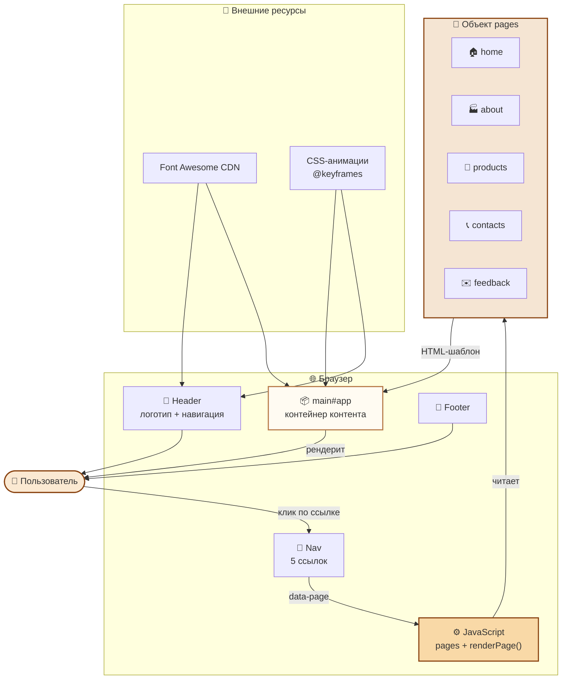
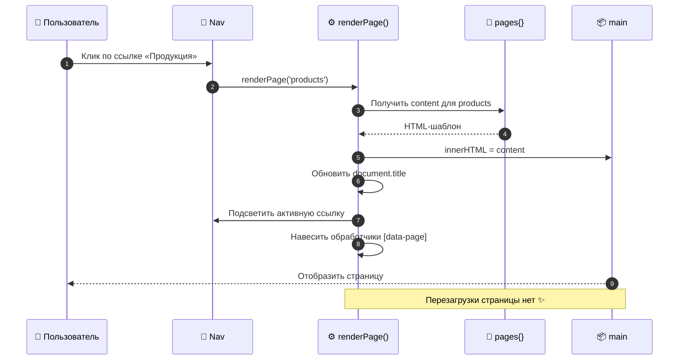
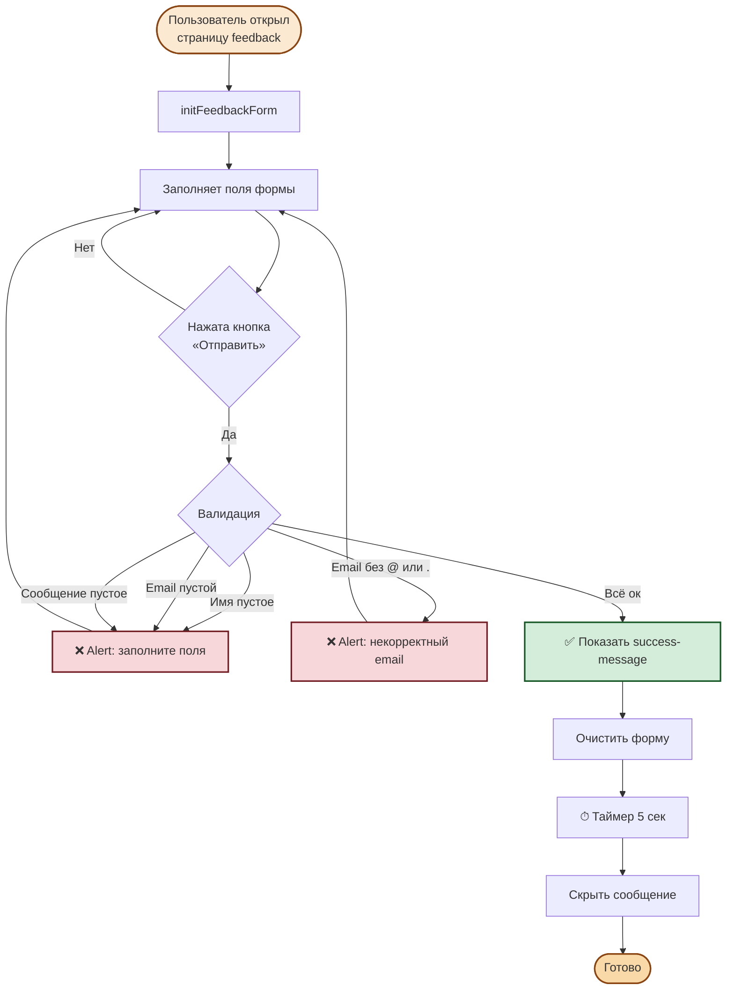
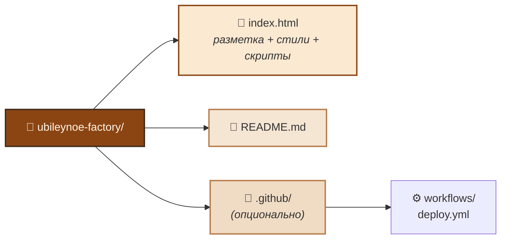
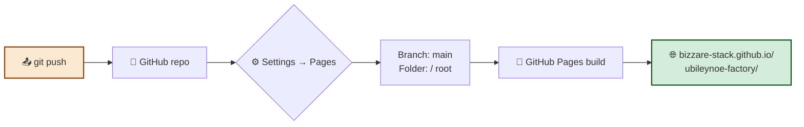

# 🍪 Завод «Юбилейное» — статический сайт

Демонстрационный статический сайт вымышленного завода по производству легендарного печенья **«Юбилейное»**. Проект создан как пример одностраничного приложения (SPA) на чистом HTML, CSS и JavaScript — без фреймворков и сборщиков.


---

## 📖 О проекте

Сайт рассказывает о вымышленном заводе, который производит печенье «Юбилейное» с 1913 года. Реализован как **одностраничное приложение** с клиентской навигацией: контент 5 страниц рендерится динамически через JavaScript без перезагрузки.

Проект подойдёт как:
- 🎓 учебный пример для изучения нативного JS и SPA-подхода;
- 🧩 шаблон для лендинга или корпоративного сайта небольшой компании;
- 🎨 референс по CSS-анимациям и адаптивной вёрстке.

---

## ✨ Возможности

- **5 страниц** с переключением без перезагрузки:
  - 🏠 **Главная** — hero-блок, преимущества завода, призыв к действию
  - 🏭 **О заводе** — история, ценности, факты о производстве
  - 🍪 **Продукция** — галерея сортов печенья
  - 📞 **Контакты** — адрес, телефоны, email, режим работы
  - ✉️ **Обратная связь** — форма с валидацией и подтверждением отправки
- **Анимации** — плавное появление блоков (`fadeUp`, `scaleIn`, `slideInLeft`), покачивание логотипа, hover-эффекты на карточках и кнопках
- **Адаптивная вёрстка** — корректно работает на десктопе, планшетах и смартфонах
- **Валидация формы** — проверка заполнения полей и корректности email
- **Иконки Font Awesome** — подключены через CDN
- **Единый стиль** — тёплая «печенюшная» палитра, подчёркивающая бренд

---

## 🏗 Архитектура приложения



---

## 🔄 Схема навигации (SPA)



---

## 🧠 Логика работы формы обратной связи



---

## 📂 Структура проекта



```
ubileynoe-factory/
├── index.html      # Вся разметка, стили и скрипты в одном файле
└── README.md       # Этот файл
```

> Всё приложение уместилось в один HTML-файл: стили — в `<style>`, логика — в `<script>`. Такой подход удобен для демонстрации и быстрого деплоя на GitHub Pages.

---

## 🚀 Запуск

### Локально

1. Склонируйте репозиторий:
   ```bash
   git clone https://github.com/your-username/ubileynoe-factory.git
   ```
2. Перейдите в папку проекта:
   ```bash
   cd ubileynoe-factory
   ```
3. Откройте `index.html` в браузере (двойным кликом или через Live Server).

### GitHub Pages



1. Запушьте проект в репозиторий на GitHub.
2. Перейдите в **Settings → Pages**.
3. Выберите ветку `main` и папку `/ (root)`.
4. Сохраните — сайт будет доступен по адресу `https://your-username.github.io/ubileynoe-factory/`.

> ⚠️ Файл **обязательно** должен называться `index.html` и лежать в корне — иначе GitHub Pages вернёт 404.

---

## 🧭 Как работает навигация

Контент всех страниц хранится в JS-объекте `pages`:

```javascript
const pages = {
  home:     { title: 'Главная',        content: `...` },
  about:    { title: 'О заводе',       content: `...` },
  products: { title: 'Продукция',      content: `...` },
  contacts: { title: 'Контакты',       content: `...` },
  feedback: { title: 'Обратная связь', content: `...` },
};
```

При клике по пункту меню вызывается `renderPage(pageKey)`, который:
1. подставляет HTML в `<main id="app">`;
2. обновляет `<title>` документа;
3. подсвечивает активную ссылку;
4. навешивает обработчики на внутренние кнопки навигации;
5. инициализирует форму, если открыта страница «Обратная связь».

---

## 📝 Форма обратной связи

Форма на странице «Обратная связь» включает поля:
- **Имя** (обязательное)
- **Email** (обязательное, с проверкой формата)
- **Тема обращения** (выпадающий список)
- **Сообщение** (обязательное, textarea)

После отправки:
- выполняется валидация;
- отображается сообщение об успехе (`<div class="success-message">`);
- форма сбрасывается;
- сообщение автоматически скрывается через 5 секунд.

> ⚠️ Сейчас данные **никуда не отправляются** — это демонстрация. Для реальной работы подключите бэкенд или сервис вроде Formspree / EmailJS.

---

## 🎨 Кастомизация

| Что менять | Где искать |
|------------|------------|
| Цвета бренда | CSS-переменные в `body` и `header` (`#8b4513`, `#fef9e9`, `#d4a373`) |
| Скорость анимаций | Значения `duration` в правилах `@keyframes` и `animation` |
| Тексты страниц | Объект `pages` в `<script>` |
| Иконки | Классы Font Awesome (`fa-cookie-bite`, `fa-industry` и т.д.) |
| Список продукции | Блок `.gallery` на странице `products` |

---

## 🌐 Совместимость

Проект протестирован в актуальных версиях:
- Chrome / Edge
- Firefox
- Safari
- Opera

Требуется поддержка ES6 и CSS-анимаций (все современные браузеры).

---

## 📄 Лицензия

Проект распространяется под лицензией **MIT** — используйте свободно в учебных и коммерческих целях.

> Бренд «Юбилейное» и логотипы являются собственностью их правообладателей. Сайт создан в демонстрационных целях и не связан с реальным производителем.

---

## 🙌 Благодарности

- [Font Awesome](https://fontawesome.com/) — за иконки
- Вдохновение — легендарному печенью «Юбилейное» 🍪

---

<p align="center">Сделано с любовью к печенью и чистому коду ❤️</p>